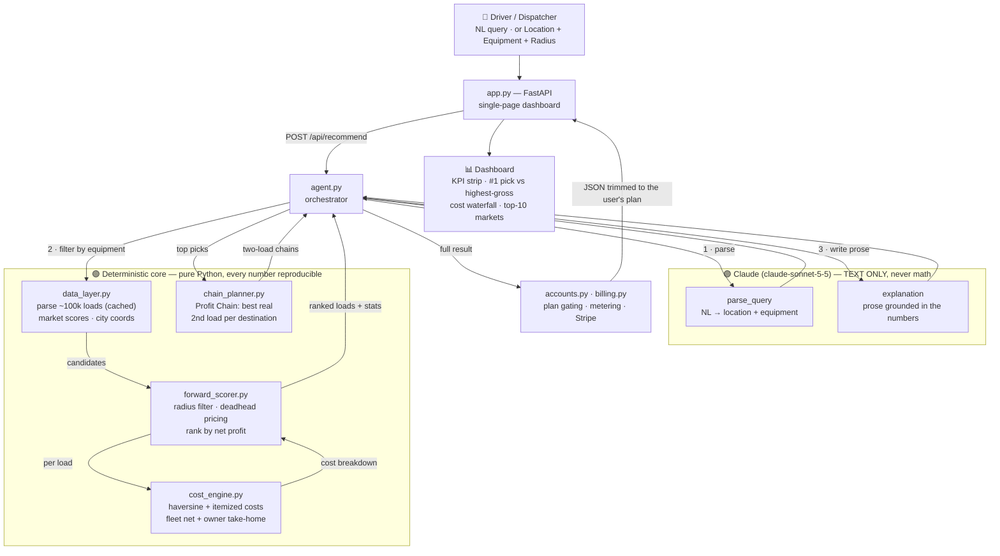

# ProfitLane 🚛

**See what you actually keep.** The load board that ranks by net profit, not gross.

**🔗 Live demo: https://rohitdvv.github.io/profitlane/**

A load-recommendation agent for owner-operators, small fleets and dispatchers. Started as
Buildathon Statement 6; now a freemium product (Free / Pro $39 / Fleet $29 per truck).
See [STRATEGY.md](STRATEGY.md) for the business plan and research behind it.

## Core Idea
ProfitLane recommends the single load with the **highest NET profit** (not gross), correctly accounting for where the truck ends up. A load that pays more but drops you in a dead market can be worse than a lower-gross load that leaves you in a strong one — because a dead-market ending forces a long empty (deadhead) drive to find the next load. ProfitLane prices that in.

**Profit Chain (Pro)** goes one step further: instead of *guessing* the empty drive after
delivery, it finds the best real load posted out of each destination for the delivery day and
costs the two loads together. The best two-load plan often does **not** start with the #1
single load. Example (Chicago, dry van): Joliet → Miami looks weak alone (weak market, ~223 mi
estimated empty), but a Fort Lauderdale → Newark load picks up the day it delivers, so the
chain nets $3,117 over 5.6 days.

## The Money Math Rule (sacred)
- All cost, profit, deadhead-out estimation, and ranking is **pure deterministic Python**.
- The LLM (Claude) is used **only** to:
  1. Parse natural language into (location, equipment)
  2. Write the human-readable explanation
- Every dollar you see on screen can be reproduced by reading the code.

## Architecture

The LLM sits **only at the edges** — parsing the request in, writing prose out. Everything
between (filtering, distance, cost, ranking) is deterministic Python. Numbers never pass
through the model.



**Flow:** request → `agent.py` asks Claude to parse it → `data_layer` filters loads by
equipment → `forward_scorer` keeps loads within pickup radius, prices deadhead from the
destination market, and calls `cost_engine` for each → ranks by net profit → Claude writes
a grounded summary → `app.py` renders the dashboard. The two purple nodes are the *only*
LLM calls; both produce text, never figures.

## Quick Start

```bash
# 1. Install
pip install -r requirements.txt

# 2. (Optional) for natural language parsing + explanations
export ANTHROPIC_API_KEY=sk-...

# 3. Run the UI (FastAPI + single HTML page)
uvicorn app:app --port 8000
#   then open http://127.0.0.1:8000
```

The Location + Equipment controls always work (no API key required). The
natural-language box and the prose explanation light up when `ANTHROPIC_API_KEY`
is set; without it, a deterministic fallback explanation is shown.

## Data
Uses the provided ~100k synthetic load dataset (`loads_part_*.txt`). The dataset is
**not** committed (read-only, not redistributed). To run with data:

```bash
mkdir -p data
cp /path/to/loads_part_*.txt data/      # or: export LOADS_DATA_DIR=/path/to/text
```

The loader auto-discovers `./data/`, `../data/`, or `$LOADS_DATA_DIR`, parses the 4
different text record formats present, and builds market coords from the ~33% of
records that include lat/lon (covers all 99 markets).

## Key Files
- `config.py` — all constants, brand, plans/pricing, model (`claude-sonnet-5-5`, override with `PROFITLANE_MODEL`)
- `cost_engine.py` — haversine + full itemized cost math (unit tested)
- `data_layer.py` — robust parser + precomputed market scores + CITY_COORDS
- `forward_scorer.py` — destination-aware deadhead adjustment + net ranking
- `chain_planner.py` — Profit Chain: two-load lookahead (deterministic)
- `agent.py` — orchestrator + thin Claude layer
- `accounts.py` — SQLite: accounts, plans, daily metering, money-found ledger, leads, partner clicks; `apply_plan()` gating
- `billing.py` — Stripe Payment Links + webhook signature check (no SDK)
- `app.py` — FastAPI server (API, billing, admin)
- `web/index.html` — the whole front end: one dependency-free page (light/dark, responsive, board, markets, pricing, paywall)
- `tests/` — cost math, plan gating, metering, Stripe webhook, chain math

## Live demo (GitHub Pages)
GitHub Pages only serves static files, so the demo is the same `web/index.html` plus
`web/static-shim.js`, which answers the page's `/api/*` calls from JSON precomputed by the real
engine for 20 cities x 4 equipment types (250 mi radius, Pro view). Accounts, payments and live
search need the FastAPI server. Rebuild after engine or UI changes:

```bash
LOADS_DATA_DIR=/path/to/text python scripts/build_static.py   # writes ./docs
```

Only computed results (top loads per search) are published in `docs/`, never the raw dataset.

## Making money (setup runbook)
Everything works with zero config; each env var below switches on a revenue path. See `.env.example`.

| Path | Turn it on | What happens |
|---|---|---|
| **Manual sales (day 1)** | `PROFITLANE_ADMIN_TOKEN` | Upgrade buttons capture leads. Bill by invoice, then `POST /admin/grant {"email","plan"}`. |
| **Self-serve subscriptions** | `STRIPE_LINK_PRO_URL/_ID`, `STRIPE_LINK_FLEET_URL/_ID`, `STRIPE_WEBHOOK_SECRET` | Upgrade → Stripe Payment Link → webhook grants the plan bought; cancellation downgrades. |
| **Factoring referrals** | `PARTNER_FACTORING_URL` | "Get paid in 24 hours" on the #1 pick, through tracked `/go/factoring`. |
| **Fuel card referrals** | `PARTNER_FUEL_URL` | Per-load fuel savings estimate + tracked `/go/fuel`. |
| **Fleet API** | (automatic on Fleet plan) | API key issued; `POST /v1/recommend` with `Authorization: Bearer <key>`. |

Operator metrics: `curl -H "X-Admin-Token: $PROFITLANE_ADMIN_TOKEN" localhost:8000/admin/metrics`
(accounts by plan, MRR estimate, searches today, leads, partner clicks, money found for users).

**Plans** (set in `config.PLANS`, enforced server-side):
Free: 5 searches/day, #1 pick vs highest-gross, top 3 loads, Profit Chain teaser.
Pro $39/mo: full board, Profit Chain, unlimited searches.
Fleet $29/truck/mo (min 3): everything plus the API.

## Load-board behavior (deterministic, in config.py)
- **Pickup radius** (`PICKUP_RADIUS_MILES`, default 250): only loads originating within
  this distance of the driver are considered. Deadhead-in is resolved from the
  market->coords table (reliable; 2/3 of records omit inline lat/lon), not per-row coords.
- **Hide unprofitable** (`HIDE_UNPROFITABLE`, default on): loads with net < 0 are filtered
  out and counted in the stats strip. ~45% of raw loads lose money once deadhead is priced —
  that is real freight economics, and finding the profitable needle is the product.
- **Two accounting models** (UI toggle, both computed in `cost_engine.py`):
  - **Fleet** (spec default): driver pay is a cost. `net_profit = gross - all costs`.
  - **Owner-operator**: driver pay is take-home. `owner_net_profit = net_profit + driver_pay`.

## Market Score Formula (documented)
```
market_score = 0.40 * norm(outbound_demand)
             + 0.35 * norm(lane_balance)
             + 0.25 * norm(rate_level)
```
lane_balance = loads_out / loads_in (high = easy to leave)

## Demo "Aha" Moment for users
The UI prominently shows #1 (by net) next to the highest-gross load so judges immediately see why the smart recommendation can have lower gross but much higher net.

## Notes
- No cloud, no database server. Everything local (business data in a SQLite file).
- The dataset is a 4-day snapshot (pickups 6/15–6/18), so loads delivering after 6/18
  have no posted follow-on load and Profit Chain correctly reports none for them.
- Parser handles the 4 different text formats present in the dataset.
